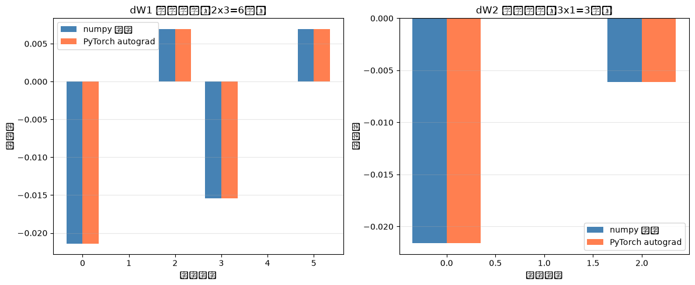

# 从零理解反向传播：numpy vs autograd 数值对比

> 你真的懂反向传播吗？不如亲手写一遍，和 PyTorch 对账验证。

## 🎯 这篇博客你会学到什么

- 反向传播的**数学推导**（链式法则的实战应用）
- 手写完整的 numpy 实现（不调库，纯数学）
- 和 PyTorch 自动求导逐层对账（梯度差异 < 1e-9）
- 为什么反向传播能把 O(5^300) 降到 O(300)

## 📌 问题引入：为什么需要反向传播？

### 前向试错法的困境

假设一个2层网络有300个参数，每个参数试5个值，暴力枚举需要 **5^300 ≈ 10^209 次计算**（宇宙原子数量才 10^80）。

反向传播用**链式法则**把复杂度降到 **O(300)** —— 这是深度学习能训练的根本原因。

---

## 🧠 核心原理：链式法则 = 逐层复用中间结果

  **链式法则是什么？**

  假设有个嵌套函数 `y = f(g(x))`，链式法则说：求导时要"外层导数乘内层导数"，即 `dy/dx = (df/dg) ×
  (dg/dx)`。神经网络就是这样一层套一层的函数，所以链式法则是反向传播的数学基础。

  **为什么反向传播比前向试错快？**

  前向试错要暴力枚举：假设有300个参数，每个试5个值，需要 **5^300 次计算**（比宇宙原子数10^80还多得多）。

  反向传播只需要：
  - **1次前向传播**：记录每层的激活值和参数到计算图
  - **1次反向传播**：从后往前，用链式法则逐层算梯度，复用计算图里的中间值

  复杂度从 **O(5^300) 降到 O(300)** ——
  关键在于每层只算一次导数，不重复计算。这就是反向传播能让深度学习可行的根本原因。
    

---

## 🔢 实战：手写2层网络

### 网络结构

```
输入层(2) → 隐藏层(3, ReLU) → 输出层(1, Sigmoid)
```

- 参数：W1(2×3), b1(3), W2(3×1), b2(1) —— 共 **12 个参数**
- 数据：4 个样本，每个样本 2 个特征
- 任务：二分类（交叉熵损失）

### 前向传播（5 行代码）

```python
Z1 = X @ W1 + b1    # (4, 3)
A1 = relu(Z1)       # (4, 3)
Z2 = A1 @ W2 + b2   # (4, 1)
A2 = sigmoid(Z2)    # (4, 1)
loss = -mean(y*log(A2) + (1-y)*log(1-A2))
```

### 反向传播推导：5个梯度公式

反向传播从损失函数开始，逐层往回算梯度。核心是链式法则：每一层的梯度 = 后一层的梯度 × 本层的局部导数。

#### 1. dZ2：输出层的梯度起点

**目标**：求 ∂Loss/∂Z2

交叉熵损失对 Sigmoid 输出层有个经典简化：

```
∂Loss/∂Z2 = A2 - y
```

**为什么？** 损失函数是 `Loss = -mean(y*log(A2) + (1-y)*log(1-A2))`，A2 = sigmoid(Z2)。用链式法则展开：
- ∂Loss/∂A2 = -(y/A2 - (1-y)/(1-A2))
- ∂A2/∂Z2 = A2(1-A2)（Sigmoid 导数）

两者相乘，分子分母约掉，得到 **A2 - y**。这是二分类的标准梯度。

**维度**：dZ2 = (4, 1)，和 Z2 一样（4个样本，1个输出神经元）

---

#### 2. dW2, db2：权重和偏置的梯度

**dW2 的推导**：

Z2 = A1 @ W2 + b2，所以 ∂Z2/∂W2 涉及 A1。用链式法则：

```
dW2 = A1.T @ dZ2
```

**为什么要转置？** Z2 的第 i 行第 j 列 = Σ(A1[i,k] × W2[k,j])，对 W2[k,j] 求导得 A1[i,k]。所有样本累加后，得到 A1.T @ dZ2。

**维度**：A1.T 是 (3, 4)，dZ2 是 (4, 1)，结果 dW2 = **(3, 1)**，和 W2 一样。

**db2 的推导**：

b2 对每个样本都加了同样的值，所以梯度是所有样本的 dZ2 求和：

```
db2 = sum(dZ2, axis=0)
```

**维度**：db2 = **(1, 1)**，和 b2 一样。

---

#### 3. dA1：梯度回传到隐藏层

现在梯度要从输出层传回隐藏层。Z2 = A1 @ W2 + b2，对 A1 求导：

```
dA1 = dZ2 @ W2.T
```

**为什么？** 链式法则：∂Loss/∂A1 = (∂Loss/∂Z2) × (∂Z2/∂A1) = dZ2 @ W2.T

**维度**：dZ2 是 (4, 1)，W2.T 是 (1, 3)，结果 dA1 = **(4, 3)**，和 A1 一样。

---

#### 4. dZ1：ReLU 的导数

A1 = ReLU(Z1)，ReLU 的导数是个 0/1 掩码：

```
dZ1 = dA1 * (Z1 > 0)
```

**为什么？** ReLU(z) = max(0, z)，导数是：
- z > 0 时，导数 = 1
- z ≤ 0 时，导数 = 0

所以 `(Z1 > 0)` 直接就是导数（返回 True/False，乘法时自动转成 1/0）。

**维度**：dZ1 = **(4, 3)**，和 Z1 一样。

---

#### 5. dW1, db1：输入层的梯度

和输出层的推导完全一样：

```
dW1 = X.T @ dZ1
db1 = sum(dZ1, axis=0)
```

**维度**：
- X.T 是 (2, 4)，dZ1 是 (4, 3) → dW1 = **(2, 3)**
- db1 = **(1, 3)**

至此，所有 12 个参数的梯度都算出来了！

---

## 🔬 对账验证：numpy vs PyTorch

### numpy 手写实现

```python
# 反向传播
dZ2 = (A2 - y) / n
dW2 = A1.T @ dZ2
db2 = np.sum(dZ2, axis=0, keepdims=True)

dA1 = dZ2 @ W2.T
dZ1 = dA1 * (Z1 > 0)  # ReLU导数
dW1 = X.T @ dZ1
db1 = np.sum(dZ1, axis=0, keepdims=True)
```

### PyTorch 自动求导

```python
loss.backward()  # 一行搞定！

# 梯度自动存在 .grad 里
print(W1.grad)
print(W2.grad)
```

### 数值对比

| 参数 | numpy 手写 | PyTorch autograd | 最大差异 |
|-----|-----------|-----------------|---------|
| dW1 | (见图)    | (见图)          | < 1e-9  |
| dW2 | (见图)    | (见图)          | < 1e-9  |



### 为什么差异 < 1e-9 就算通过？

**浮点数精度的限制**：计算机用 float32/float64 存储小数，天然有舍入误差。numpy 和 PyTorch 的底层实现（BLAS 库、并行策略）略有不同，导致微小的数值差异（比如 -0.02157385 vs -0.02157386）。

**1e-9 在深度学习中的意义**：梯度的绝对值通常在 0.001 ~ 0.1 量级，1e-9 相当于梯度本身的 **0.00001%**，完全可以忽略。训练时学习率通常是 0.001 ~ 0.01，这点误差根本不影响参数更新方向。

**如果差异 > 1e-3 呢？** 说明推导或代码有bug——可能是公式写错、矩阵维度不匹配、或者激活函数实现有问题。这时必须回去检查每一步。

---

## 💡 核心洞察

### 三个核心发现

#### 1. 关于链式法则：为什么从后往前算？

**原来以为**：从前往后、从后往前不都一样吗？

**现在发现**：必须从后往前！因为损失函数在最后，我们要求的是"每个参数对损失的影响"（∂Loss/∂W），必须从 Loss 出发逆推。如果从前往后，你根本不知道往哪个方向求导。

**更深一层**：反向传播复用了后层的梯度（dZ2 → dA1 → dZ1），如果从前往后，每层都要重新算到 Loss，变成 O(n²) 复杂度。

---

#### 2. 关于 ReLU 导数：为什么 `(Z1 > 0)` 就是导数？

**原来以为**：导数不是要算极限、求 dy/dx 吗？怎么一个布尔判断就完事了？

**现在发现**：ReLU(z) = max(0, z) 的导数确实就是 0 或 1。`Z1 > 0` 返回布尔数组（True/False），numpy 在算术运算时自动把它转成 1/0，正好就是导数！这个"巧合"让 ReLU 的反向传播只需要一行代码。

**对比**：Sigmoid 的导数是 `σ(z) * (1-σ(z))`，需要额外计算；ReLU 只需要一个比较运算，这是它快的原因之一。

---

#### 3. 关于矩阵维度：为什么 `A1.T @ dZ2` 能得到 dW2？

**原来以为**：矩阵乘法的维度匹配是"凑"出来的，只要不报错就行。

**现在发现**：维度匹配不是巧合，是**数学推导的自然结果**！

- Z2 的第 i 行第 j 列 = Σ(A1[i, k] × W2[k, j])
- 对 W2[k, j] 求导，得到 A1[i, k]
- 所有样本累加：Σ(A1[i, k] × dZ2[i, j]) = (A1.T @ dZ2)[k, j]

**关键洞察**：前向传播怎么乘（A1 @ W2），反向传播就转置后反着乘（A1.T @ dZ2）。这个规律适用于所有全连接层！

---

## 🚀 完整代码

- [`backprop_numpy.py`](backprop_numpy.py)：numpy 手写实现
- [`backprop_pytorch.py`](backprop_pytorch.py)：PyTorch 对账验证
- [`visualize_gradients.py`](visualize_gradients.py)：生成可视化图表

运行方式：

```bash
python backprop_numpy.py
python backprop_pytorch.py
python visualize_gradients.py
```

---

## 🎓 下一步

- 扩展到更深的网络（3层、5层）
- 尝试不同激活函数（Tanh、Leaky ReLU、GELU）
- 加入 Dropout、Batch Normalization
- 读 PyTorch 的 `torch.autograd` 源码

---

## 参考资料

1. [CS231n: Backpropagation](http://cs231n.stanford.edu/slides/2024/lecture_4.pdf)
2. PyTorch 官方文档：[Automatic Differentiation](https://pytorch.org/tutorials/beginner/blitz/autograd_tutorial.html)

---

**作者简介**：Java 工程师转型 AI，从零手写机器学习算法系列。[GitHub](https://github.com/你的用户名/ml-from-scratch)
